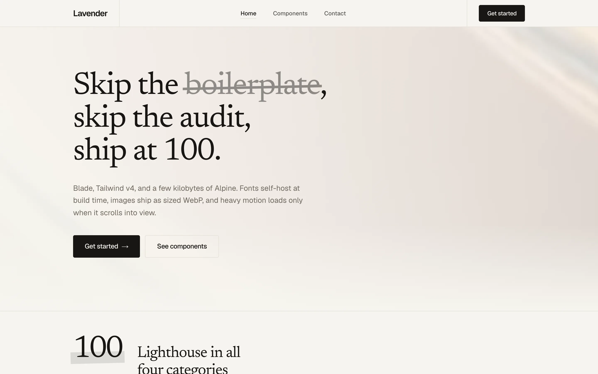
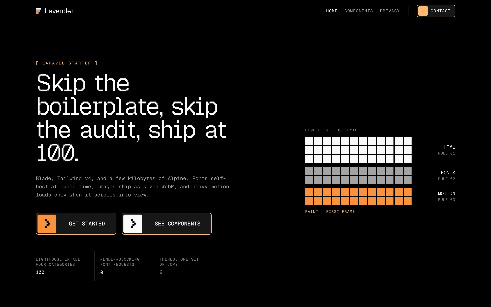

# Lavender

**An opinionated Laravel starter for technical excellence when building with agents.**

Lavender scores **100 in all five Lighthouse categories** (performance, accessibility, best practices, SEO, and the new agentic browsing) and is **agent-ready by default**. Every page is also markdown, an MCP server reads the site, agents can authenticate over OAuth, and every emerging discovery standard that Cloudflare's [isitagentready.com](https://isitagentready.com/) checks is covered. It keeps both properties as the site grows, whether you or a coding agent writes the next page.

Most starters give you a clean scaffold and leave performance to later. This one starts from a production landing page that was hand-tuned to 100. It keeps every trick that got it there, writes the reasons down where agents read them, and fails the build when a change would cost points.

| cream | pixel |
| --- | --- |
|  |  |

Three complete themes render the same routes and copy. You switch between them with one env var:

- **cream**: light and editorial. Paper, ink hairlines, Geist + Newsreader, scroll-stacked cards, a proof strip that counts up, and a native `<dialog>` mobile nav.
- **pixel**: pitch black. Geist Mono + Geist Pixel, one orange signal colour, retro pixel buttons, stepped motion, and pixel-art meters and charts. No runtime motion library: its whole JS entry is 0.3 KB on top of Alpine.
- **dusk**: deep plum night. Instrument Serif + Instrument Sans, one lavender glow, pill buttons with a light sheen, a drifting CSS sky, and a slow orbit for hero art. Also no runtime motion library.

## Opinions

- **Server-rendered HTML.** Blade, Tailwind v4, Alpine for small UI state, and Vite. No Inertia, React, or Vue. Every word and link works with JS off.
- **The performance budget is a feature.** It is tested like one (see [How it stays at 100](#how-it-stays-at-100-as-the-site-grows)).
- **One file for copy.** Every user-facing string is in `resources/copy.php`, read with `site('home.hero.lead')`. Both themes read the same keys.
- **Written rules beat tribal knowledge.** [`AGENTS.md`](AGENTS.md) is the contract for anyone changing the code. It records which rule protects which score and what breaking it cost.
- **Agents are first-class visitors.** Humans get HTML; agents get markdown, an MCP server, WebMCP tools, and OAuth, all discoverable from well-known URLs. No placeholders: every advertised endpoint is real and tested.
- **CSS for motion.** `@starting-style`, `animation-timeline: view()`/`scroll()`, `steps()`, and `::details-content`. Heavy libraries load only when their section is about to scroll into view.

## Quick start

Requires PHP 8.3+ (8.4 in the production image), Composer, Node 22, and the GD extension.

```sh
git clone <this repo> my-site && cd my-site
composer setup      # install, .env, key, SQLite migrate, npm install, build
composer dev        # http://localhost:8000
```

Pick a theme in `.env`:

```sh
THEME=pixel
```

Locally, `?theme=pixel` on any URL previews the other theme for the rest of the session. `/kit` is the component gallery for the active theme.

## Scores

Measured with Lighthouse 13 against the production Docker image (FrankenPHP, compression on), mobile preset with simulated throttling, three runs per page (`node scripts/lighthouse.mjs`):

| Page | cream | pixel |
| --- | --- | --- |
| `/` | 100 · 100 · 100 · 100 · 100 | 100 · 100 · 100 · 100 · 100 |
| `/docs/api` | 100 · 100 · 100 · 100 · 100 | 100 · 100 · 100 · 100 · 100 |
| `/contact` | 100 · 100 · 100 · 100 · 100 | 100 · 100 · 100 · 100 · 100 |
| `/privacy` | 100 · 100 · 100 · 100 · 100 | 100 · 100 · 100 · 100 · 100 |

Order: performance, accessibility, best practices, SEO, agentic browsing. Desktop is 100 across the board. `/kit` is `noindex` on purpose, so its SEO score is low.

Simulated throttling varies by a point or two between runs; cream's home page, with a full-bleed hero image and a video, is the one most likely to read 97–99 on a slow machine.

## How it gets to 100

The full playbook, with the measurements behind each rule, is in [`AGENTS.md`](AGENTS.md#loading-playbook). The short version:

**Fonts: zero third-party requests, zero layout shift**
- Fonts are downloaded **at build time** by `laravel-vite-plugin/fonts`, fingerprinted, and served from your own origin. At runtime nothing goes to Google or Bunny, so there is no preconnect and no request chain through a second origin.
- The plugin is fed from `google()`, not `bunny()`. Bunny's CSS makes the plugin emit a woff rule after the woff2 one, so browsers download both. Google returns woff2 only, often as one variable file. Font bytes went from about 220 KB to about 75 KB.
- Only the active theme's families load, and only the above-the-fold faces are preloaded. `@fonts` inlines the `@font-face` rules, so font requests start in parallel with the CSS instead of after it.
- `fontaine` generates metric-matched `"Geist fallback"` faces (`size-adjust` plus ascent/descent overrides), so the `font-display: swap` swap does not move text. Without it installed, the plugin skips this silently.

**The `<head>` is ordered for the network dependency tree**
1. meta, SEO, OG, JSON-LD
2. the LCP image preload, so it wins bandwidth
3. font preloads + inline `@font-face`
4. one stylesheet (the only render-blocking request) and one deferred module script

The critical path stays one hop deep (HTML → asset) with no third-party origin. We measured putting `@vite` first, and it scored worse.

**CSS and JS**
- One Tailwind entry per theme with `source(none)` and explicit `@source`, so neither theme ships the other's classes. The CSS is about 9 KB gzip per theme.
- No typography plugin. A hand-written prose style of about 1 KB replaces 14 KB.
- GSAP + ScrollTrigger (about 44 KB) load with a dynamic `import()` when an `IntersectionObserver` sees the section 800px away, and never load under reduced motion.
- Reveal-on-scroll only hides elements that start below the fold, so above-the-fold content is visible at first paint and can be the LCP element.

**Images**
- `php artisan images:optimize` turns `resources/images/*` into 640/960/1280 WebP at q80. It never upscales, skips unchanged sources by hash, and writes a manifest of intrinsic sizes.
- `<x-image slug="…" alt="…">` emits `srcset`, `sizes`, `width` and `height` (no CLS), `loading="lazy"`, and `decoding="async"`. The single LCP image gets `:eager="true"` and a preload.
- Decorative backgrounds that are faded or scaled pin one small variant with `:width="640"`, so a high-DPR phone doesn't download 1280px it can't show.

**Server**
- FrankenPHP/Caddy with `encode zstd gzip` shrinks the CSS from 46 KB to 10 KB. Files that never change under the same URL get `Cache-Control: immutable`. Config, routes, and views are cached at boot.

**Accessibility and SEO**
- Unique title and description per page, a canonical URL, OG tags, `WebSite` and `FAQPage` JSON-LD, and `robots.txt` and `sitemap.xml` routes. `SITE_INDEXABLE=false` switches a staging deploy to noindex.
- Every colour pair passes contrast. Decorative text stays out of the accessibility tree through CSS `content` with empty alt text. FAQs are native `<details>`, so the answers stay in the DOM and match the JSON-LD.

## Agent-ready by default

Where Cloudflare's [isitagentready.com](https://isitagentready.com/) scanner takes a site with only `robots.txt` and a sitemap to its top level, Lavender starts there. It passes every check that can live in the app. The one that can't is DNS-AID, because those are DNS records; `php artisan agents:dns` prints them for your domain.

| Check | What Lavender serves |
| --- | --- |
| **robots.txt AI rules** | Explicit `User-agent` groups. Search and user-initiated fetchers (assistant search indexes and user-initiated fetches) are allowed; training crawlers (the model-training crawlers) are disallowed unless `AGENTS_ALLOW_TRAINING=true` |
| **Content Signals** | `Content-Signal: search=yes, ai-input=yes, ai-train=no`: be found and cited, don't be trained on |
| **Link headers** (RFC 8288) | Every page points at `api-catalog`, `service-desc`, `service-doc`, `describedby`, and `status` |
| **Markdown for Agents** | `Accept: text/markdown` returns the page's main content as markdown with `X-Markdown-Tokens`. Browsers still get HTML, with `Vary: Accept` for caches |
| **llms.txt** | Every public page with a summary, plus the agent entry points |
| **API catalog** (RFC 9727) | `/.well-known/api-catalog` linking OpenAPI 3.1, the docs page, and `/up` |
| **MCP server** | `/mcp` on the official `laravel/mcp` package: `list_pages`, `read_page` (public), and `send_inquiry` (token). The server card at `/.well-known/mcp/server-card.json` is generated from the server, so it can't drift |
| **OAuth for agents** (RFC 8414, 9728, 7591, 7009) | Agents register themselves, trade client credentials for short-lived Sanctum bearer tokens, and can be rate limited and revoked individually. Discovery metadata plus `/auth.md` with an `agent_auth` block |
| **Agent Skills** (discovery v0.2.0) | `resources/agent-skills/*/SKILL.md`, published with SHA-256 digests of the exact bytes served |
| **WebMCP** | The same tools registered with `navigator.modelContext` for in-browser agents, and the contact form annotated with declarative `toolname`/`tooldescription`. It only runs in browsers that ship the API |
| **ARD** | `/.well-known/ai-catalog.json` with `urn:air:` identifiers, ARD media types, and representative queries, plus `<link rel="ai-catalog">` |
| **Lighthouse Agentic Browsing** | 100: a well-formed accessibility tree, no layout shift, valid llms.txt and ai-catalog, registered WebMCP tools |

Try it:

```sh
curl -H 'Accept: text/markdown' http://localhost:8000/
# MCP: add http://localhost:8000/mcp to any client as a Streamable HTTP server
```

`/docs/api` documents it for people. [`tests/Feature/AgentReadinessTest.php`](tests/Feature/AgentReadinessTest.php) asserts every check. It also runs the MCP and OAuth flows end to end and follows every `Link` target, so an advertised URL can't quietly 404. None of this costs page speed: the Link header is a few bytes, markdown is only rendered on request, and the WebMCP code adds under 1 KB gzip.

## How it stays at 100 as the site grows

Scores decay one small change at a time: a Google Fonts link, a second stylesheet, an unsized image, a library imported at the top of the entry. The starter guards against that at three levels.

1. **The rules live where agents look.** [`AGENTS.md`](AGENTS.md) (with `CLAUDE.md` pointing to it) is written for coding agents. It covers architecture, the loading playbook, head order, image rules, mobile-nav behaviour, how to measure, and how to add a theme. Each rule names the score it protects. [`docs/themes/*.md`](docs/themes) holds the visual rules per theme, so new UI matches the rest of the theme.
2. **Components carry the defaults.** `<x-image>` can't render an unsized or eager-by-accident image. The head partial fixes the load order. The theme config decides which fonts load. A new page gets the right behaviour by using the existing parts.
3. **Tests enforce the contract.** [`tests/Feature/PerformanceContractTest.php`](tests/Feature/PerformanceContractTest.php) runs against the real Vite build for every page in every theme and fails when:
   - a page has more than one render-blocking stylesheet or any classic `<script>`
   - anything in `<head>` loads from a third-party origin, or the CSS `@import`s remote fonts
   - font preloads come after the stylesheet, or the LCP image preload comes after the fonts
   - fontaine fallback faces are missing
   - an image lacks intrinsic `width` and `height` or `alt`, or more than one image is high priority
   - a theme goes over **12 KB of CSS**, **25 KB of initial JS**, or **60 KB of preloaded fonts** (gzip)

   `PagesTest` renders every page in both themes and checks canonical, description, the favicon, the themed 404, robots, and the sitemap. Adding a page means adding a row there, and that single row enrols the page in the contract. Adding it to `Agents::pages()` puts it in the sitemap, llms.txt, and the MCP tools in one go.

CI ([`.github/workflows/tests.yml`](.github/workflows/tests.yml)) runs Pint and the full suite on every push and pull request. For real scores, the manual [Lighthouse workflow](.github/workflows/lighthouse.yml) builds the production image, serves each theme, and runs current Lighthouse (13+) through [`scripts/lighthouse.mjs`](scripts/lighthouse.mjs). It asserts 100 for accessibility, best practices, SEO, and agentic browsing, and at least 95 for median mobile performance. It is manual because shared runners add noise to performance timings; the contract test is the gate that runs on every push.

## Working with agents

The repository is set up so an agent can make changes without breaking the scores.

- Start the agent at `AGENTS.md`. It holds the commands, the layout table, the rules, and the reasons behind them, including how to add an MCP tool or an agent skill.
- Put new copy in `resources/copy.php`, new pages in both `resources/views/themes/*/pages/`, and new components in the theme's `components/` and on `/kit`.
- Tell the agent to finish with `npm run build && php artisan test`. A red contract test explains in plain words which rule broke.
- Before merging UI work, measure against the Docker image (commands in [AGENTS.md → Measuring](AGENTS.md#measuring)) or run the Lighthouse workflow.

## What is in the box

| | |
| --- | --- |
| Pages | `/` home, `/contact` (validated form with honeypot, stored in `inquiries`), `/docs/api` (API and agents), `/privacy` (markdown), `/kit` (component gallery, noindex), themed 404 |
| SEO | Per-page title and description, canonical, OG, JSON-LD, `/robots.txt`, `/sitemap.xml`, `SITE_INDEXABLE` switch |
| Agents | Markdown negotiation, `/llms.txt`, `/mcp`, WebMCP, OAuth client credentials, `/auth.md`, OpenAPI, and `/.well-known/{api-catalog, ai-catalog.json, mcp/server-card.json, agent-skills, oauth-*}` |
| Fonts | Self-hosted at build time, preloads per theme, metric-matched fallbacks |
| Images | `images:optimize` → responsive WebP + manifest; `<x-image>`; `ASSET_CDN_URL` for a CDN |
| Motion | CSS first; GSAP only on demand; every effect has a reduced-motion branch |
| Theming | `THEME` env, `theme::` view namespace, `<x-cream::…>` / `<x-pixel::…>` / `<x-dusk::…>` components, local `?theme=` preview |
| Production | Multi-stage `Dockerfile` on FrankenPHP; zstd/gzip, immutable caching, `/up` healthcheck, migrations on boot |
| Tests | Pages in both themes, performance contract, agent readiness (MCP, OAuth, discovery), contact form, image pipeline |

```
app/Support/Theme.php              active theme, view namespace, per-request preview
app/Support/Images.php             manifest-backed srcset / sizes / CDN URLs
config/theme.php                   themes: Vite entries, font aliases, theme colour
app/Support/Agents.php             public pages, skills, robots.txt, HTML → markdown
app/Mcp/                           MCP server and tools
routes/ai.php                      /mcp, /oauth/*, /.well-known/*, llms.txt, auth.md
config/agents.php                  crawler policy, token lifetime, scopes
resources/agent-skills/            SKILL.md files published to agents
resources/copy.php                 every user-facing string
resources/views/partials/head.blade.php   the load-bearing <head>
resources/views/themes/{cream,pixel,dusk}/  layouts, components, pages, errors
resources/css/{cream,pixel,dusk}.css  one Tailwind entry per theme
resources/js/{cream,pixel,dusk}.js    one JS entry per theme; shared modules in lib/
docker/                            Caddyfile, php.ini, entrypoint
```

## Deploy

```sh
docker build -t site .
docker run -p 8080:8080 --env-file .env site
php artisan agents:dns --host=example.com   # DNS-AID records for your DNS provider
```

Set `APP_URL` to the public origin: every discovery document is built from it. Container disk is ephemeral, so point `DB_URL` at a real database in production. The entrypoint caches config, routes, and views and runs migrations. Because config is cached, read `env()` only inside `config/*.php`.

## Adding a theme

Follow [AGENTS.md → Adding a theme](AGENTS.md#adding-a-theme): add a config entry, a CSS and JS entry, views under `resources/views/themes/{name}/`, a favicon, and a design doc, and add the theme to the tests' data provider. The contract test then covers the new theme too.

## Credits

- Fonts: Geist, Geist Mono, Geist Pixel, and Newsreader, under the SIL Open Font License. They are downloaded at build time and not vendored here.

## License

[MIT](LICENSE)
